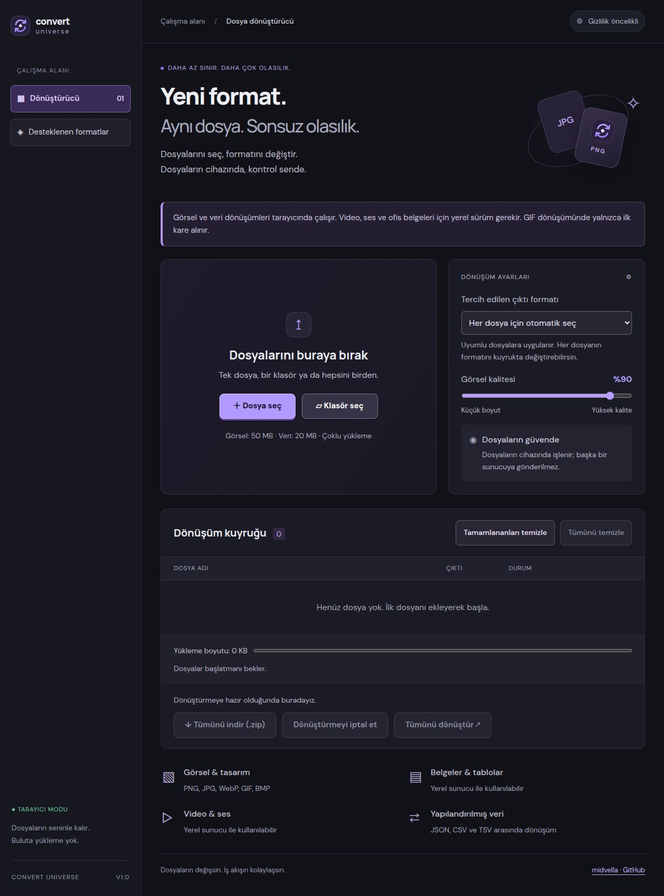
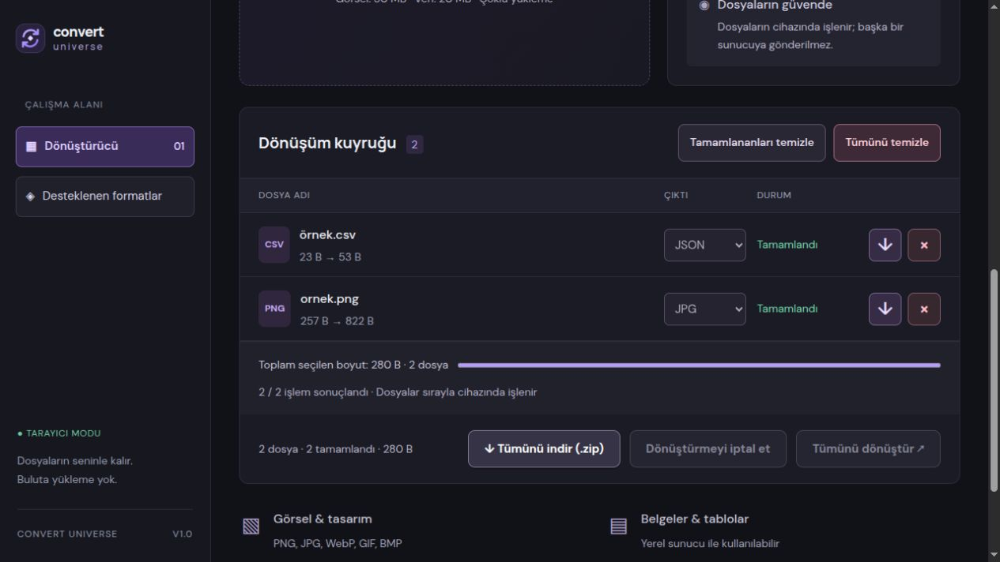
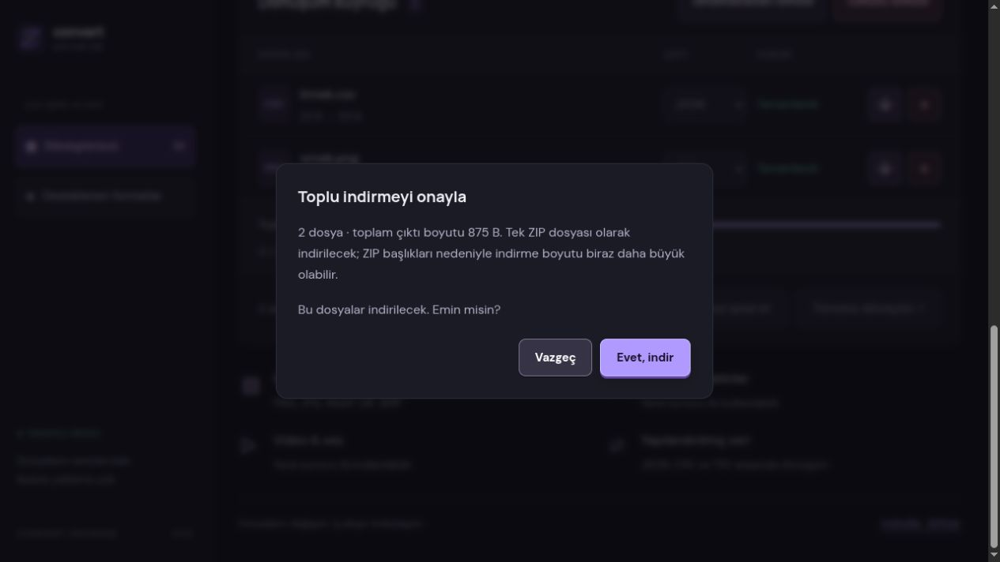

# Convert Universe

Bilgisayarınızda çalışan, tarayıcı arayüzüne sahip Türkçe dosya dönüştürücü. Dosyaları kuyruğa ekleyin, her biri için çıktı formatını seçin ve sonuçları tek tek veya ZIP olarak indirin.

Python sunucusunu başlatın ve uygulamayı localhost üzerinden açın. Görsel, video, ses, ofis belgesi ve veri dönüşümleri yerel motorlarla bilgisayarınızda işlenir; dosyalar üçüncü taraf bir dönüşüm servisine gönderilmez.

<p align="center">
  
</p>

[Özellikler](#özellikler) · [Kurulum](#kurulum) · [Desteklenen formatlar](#desteklenen-formatlar) · [Testler](#testler)

## Özellikler

- Tek dosya, çoklu dosya ve klasör seçimi; sürükle-bırak desteği.
- Kullanıcı başlatana kadar bekleyen dönüşüm kuyruğu.
- Dosya başına hedef format seçimi ve uyumlu dosyalara ortak format uygulama.
- JPG ve WebP çıktıları için görsel kalite ayarı.
- Dosya boyutları, toplam seçilen boyut ve sonuçlanan işlem sayısı.
- Dönüşümü iptal etme, yeniden başlatma ve kuyruğu temizleme.
- Dosya bazında hata bildirimi; diğer dosyaların işlenmeye devam etmesi.
- Tekli indirme ve ZIP olarak toplu indirme.
- Dosya sayısını ve boyutunu gösteren indirme onayı.
- Koyu tema, mobil ekranlara uyumlu düzen ve klavye odak göstergeleri.

## Ekran görüntüleri

Görüntüler uygulamanın tarayıcı modundan, örnek dosyalar kullanılarak alınmıştır.

### Dönüşüm kuyruğu

Dosyaların giriş ve çıktı boyutları, seçilen hedef formatlar ve dönüşüm sonuçları aynı listede gösterilir.



### İndirme onayı

Tekli ve toplu indirme işlemleri onay gerektirir. Vazgeçmek veya pencereyi kapatmak bekleyen indirme isteğini temizler.



## Nasıl çalışır?

Tarayıcı arayüzü, aynı bilgisayarda çalışan Python sunucusuna bağlanır. Sunucu görseller için Pillow, video ve ses için FFmpeg, ofis belgeleri için LibreOffice kullanır. JSON, CSV ve TSV dönüşümleri Python ile işlenir.

Dosyalar işlenmek üzere yerel geçici dizine alınır. Arayüz aynı anda tek dosya yükler ve en fazla iki sunucu işini yürütür. Kullanılabilir hedefler **Desteklenen formatlar** bölümünde gösterilir.

## Kurulum

Gereksinimler:

- Python 3.10 veya üzeri.
- Pillow; `requirements.txt` üzerinden kurulur.
- Video ve ses işlemleri için FFmpeg.
- Ofis belgeleri için LibreOffice.

Proje kökünde bir sanal ortam oluşturun:

```bash
python3 -m venv .venv
source .venv/bin/activate
python -m pip install -r requirements.txt
python server.py
```

Uygulama [http://127.0.0.1:8765/](http://127.0.0.1:8765/) adresinde açılır. Sunucuyu durdurmak için terminalde `Ctrl+C` kullanın.

Ubuntu/Debian üzerinde isteğe bağlı dönüşüm motorları:

```bash
sudo apt install ffmpeg libreoffice
```

Farklı bir port kullanmak için:

```bash
PORT=9000 python server.py
```

FFmpeg veya LibreOffice kurulu değilse ilgili dönüşümler sunucu tarafından sunulmaz. Yerel süreç iptali POSIX süreç gruplarını kullanır; mevcut kurulum ve doğrulama Linux içindir. Windows için WSL kullanılabilir.

## Kullanım

1. **Dosya seç** veya **Klasör seç** ile dosyaları ekleyin. Dosya ve klasörleri yükleme alanına sürüklemek de mümkündür.
2. Her dosyanın çıktı formatını seçin. Ortak format tercihi yalnızca uyumlu dosyalara uygulanır.
3. Toplam seçilen boyutu kontrol edin ve **Tümünü dönüştür** düğmesine basın. Dosya seçimi tek başına dönüşümü başlatmaz.
4. Gerekirse **Dönüştürmeyi iptal et** ile kuyruğu durdurun. İptal edilmiş veya hatalı dosyalar yeniden başlatılabilir.
5. Tamamlanan bir dosyayı indirme düğmesiyle seçin veya bütün dosyalar başarılı olduğunda **Tümünü indir (.zip)** kullanın.
6. Dosya sayısını ve çıktı boyutunu inceleyip indirmeyi onaylayın.

### Kuyruk ve indirme kuralları

- Çok sayıda dosya seçmek aynı anda çok sayıda yükleme başlatmaz. Yeni yüklemeler, sunucudaki iki iş sınırına göre bekletilir.
- **Tümünü indir** yalnızca kuyruktaki her dosya başarıyla tamamlandığında etkinleşir. Hatalı, iptal edilmiş veya desteklenmeyen dosyalar yeniden işlenmeli ya da listeden kaldırılmalıdır.
- **Vazgeç**, Escape veya indirme penceresini kapatma bekleyen indirme isteğini temizler. Dönüştürülmüş çıktı kuyrukta kalır; yeniden indirmek yeni bir onay gerektirir.
- **Tamamlananları temizle**, başarılı, iptal edilmiş ve desteklenmeyen satırları kaldırır. **Tümünü temizle**, çalışan kuyruğu durdurduktan sonra bütün satırları kaldırır. Kaynak dosyalar silinmez.
- Klasör içeriği düz bir listeye alınır. ZIP içindeki dosya adlarına çakışmayı önlemek için sıra numarası eklenir.
- Sayfa yenilendiğinde veya kapatıldığında istemci kuyruğu kaybolur.

## Desteklenen formatlar

| Kategori | Girdi | Çıktı |
| --- | --- | --- |
| Görsel | PNG, JPG, JPEG, WebP, BMP, TIFF, TIF, GIF, ICO, PPM, TGA, AVIF | PNG, JPG, WebP, TIFF, BMP, GIF, ICO, PDF |
| Video | MP4, MKV, MOV, AVI, WebM, M4V, MPG, MPEG, WMV, FLV, TS, 3GP | MP4, WebM, MKV, MOV, GIF, MP3, WAV, FLAC, OGG, M4A, Opus |
| Ses | MP3, WAV, FLAC, OGG, M4A, AAC, Opus, AIFF, WMA | MP3, WAV, FLAC, OGG, M4A, AAC, Opus, AIFF |
| Belge | DOC, DOCX, ODT, RTF, TXT, HTML, HTM | PDF, DOCX, ODT, RTF, TXT, HTML |
| Tablo | XLS, XLSX, ODS | PDF, XLSX, ODS, CSV |
| Sunum | PPT, PPTX, ODP | PDF, PPTX, ODP |
| Veri | JSON, CSV, TSV | JSON, CSV, TSV |

Codec ve format desteği kurulu motorlara bağlıdır; her girdi/çıktı birleşimi garanti edilmez. CSV girdileri veri dönüştürücüsüyle işlenir. JSON girdisi nesnelerden oluşan bir dizi olmalıdır. CSV/TSV verileri UTF-8 olarak okunur ve metin değerleri korunur.

## Sınırlar ve veri saklama

| Sınır | Değer |
| --- | --- |
| Dosya boyutu | Dosya başına 512 MB |
| Eşzamanlı yükleme | 1 dosya |
| Eşzamanlı dönüşüm | En fazla 2 sunucu işi |
| Arayüzden ZIP indirme | Toplam 256 MB çıktı |
| Motor zaman aşımı | FFmpeg/LibreOffice için 300 saniye |

- ZIP çıktıları sıkıştırmadan paketlenir. Boyut sınırlarının altında da cihaz belleğine bağlı hatalar oluşabilir.
- PDF girdi dönüşümü, OCR, CAD ve arşiv açma desteklenmez. Şifreli veya bozuk dosyalar hata verebilir.
- Görsellerde çok sayfalılık ve animasyon korunmaz. Ofis dönüşümlerinde font ve sayfa düzeni değişebilir.
- İptal, çalışan FFmpeg/LibreOffice süreçlerini sonlandırır. Başlamış Pillow işlemi tamamlanabilir; iptal edilen sonuç kullanılmaz. Devam eden yüklemenin iptali, sunucudan iş kimliği alındıktan sonra tamamlanır.
- Yerel dosyalar işletim sisteminin geçici dizininde tutulur. Normal sunucu kapanışında silinir; zorla sonlandırmadan sonra diskte kalabilir. Kuyruktan satır kaldırmak yerel geçici dosyayı hemen silmez.
- Sunucu `127.0.0.1` üzerinde kişisel kullanım için tasarlanmıştır. Kimlik doğrulama, disk kotası ve çok kullanıcılı izolasyon içermez; doğrudan internete açık bir dönüşüm servisi olarak dağıtılmamalıdır.
- Web fontları Google Fonts üzerinden alınır. İnternet erişimi yoksa sistem fontları kullanılır; dönüşüm dosyaları bu servise gönderilmez.

## Proje yapısı

```text
Convert-Universe/
├── docs/screenshots/            # README ekran görüntüleri
├── tests/
│   ├── browser-engine.test.cjs  # Veri dönüşümü ve ZIP testleri
│   ├── queue.test.cjs           # Kuyruk, iptal ve indirme onayı testleri
│   └── test_conversion.py      # Yerel dönüşüm motoru testleri
├── web/
│   ├── index.html              # Uygulama arayüzü
│   ├── style.css               # Koyu tema ve duyarlı yerleşim
│   ├── app.js                  # Kuyruk ve kullanıcı etkileşimleri
│   ├── browser-engine.js       # Tarayıcı dönüşümleri ve ZIP üretimi
│   └── logo.svg
├── requirements.txt
└── server.py                   # Yerel API ve dönüşüm işçileri
```

## Testler

Tarayıcı tarafındaki kontroller için Node.js 20 veya üzeri kullanın:

```bash
node --check web/app.js
node --check web/browser-engine.js
node --test tests/browser-engine.test.cjs tests/queue.test.cjs
```

Yerel motor testleri için sanal ortamda:

```bash
python -m pip install pytest
python -m pytest -q
```

Testler; CSV/TSV tırnak ve satır sonlarını, Türkçe karakterleri, geçersiz girdileri, ZIP yapısını, 500 dosyanın sırayla işlenmesini, iptali, indirme kilidini ve onaydan vazgeçmeyi kapsar. Python testleri görsel, veri, ses ve belge dönüşümlerini doğrular. FFmpeg veya LibreOffice yoksa ilgili testler atlanır; tüm formatların tek tek test edildiği anlamına gelmez.

## Katkıda bulunma

Hata bildirirken tarayıcı/işletim sistemi bilgisini, girdi ve hedef formatı, yaklaşık dosya boyutunu ve görünen hata mesajını ekleyin. Sorunu yeniden üretmek için kişisel veri içermeyen küçük bir örnek tercih edin.

Değişikliklerde web arayüzünü ve yerel API akışını birlikte doğrulayın. Yeni bir format eklerken motor desteğini, arayüzde gösterilen hedefleri ve ilgili testleri güncelleyin.

[Lisans](LICENSE)
